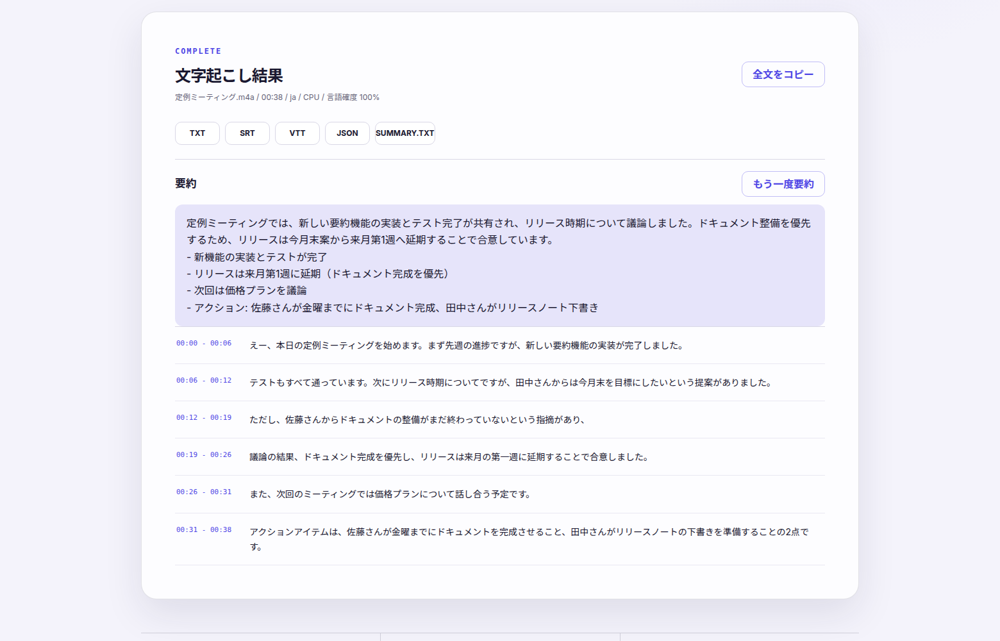
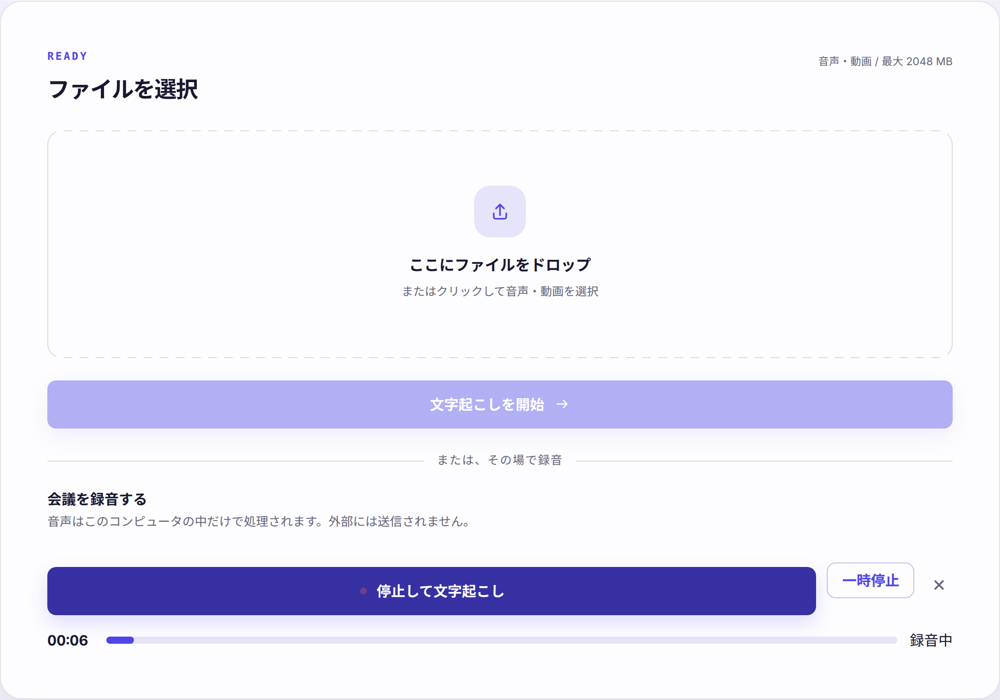

# Local Transcriber

**Private, on-device transcription for Windows and macOS.** Drop in an audio
or video file, get timestamped text — and a local-LLM summary — without
uploading your audio or text. No account, no API key, no cloud.
Linux x64 test builds can also be built locally or with GitHub Actions.

[](LICENSE)
[](https://github.com/sponsors/KOIYAL)

> 日本語のドキュメントは [README.ja.md](README.ja.md) にあります（ビルド手順・環境変数などの詳細も日本語版が正です）。

## Features

- **Fully local**: transcription (faster-whisper) and summarization run on
  your machine; source files are deleted after processing by default
- **Record meetings in the app**: one button records from the microphone
  and feeds the audio straight into transcription when you stop. Chunks
  are saved to disk every few seconds while recording, so a crash never
  loses more than the last moments. Audio stays on this computer
- **Tray resident**: the app lives in the system tray with a state-shaped
  icon (idle / recording / paused / transcribing), tray controls for
  recording, and a warning if you try to quit mid-recording
- **Zero-setup model management**: on first run the app picks a Whisper
  model that fits this computer's memory and downloads it automatically
- **Summaries on completed transcripts**: one click produces a
  same-language summary with key points, exported as `SUMMARY.TXT`
  - on supported Macs this uses **Apple Intelligence** (no download at all)
  - everywhere else, a local LLM chosen for your RAM/GPU by
    [modelshelf](https://github.com/KOIYAL/modelshelf) — shared with any
    other modelshelf-aware app on the machine, so nothing is downloaded twice
- Exports: TXT, SRT, VTT, JSON; bilingual UI (English / 日本語);
  works offline after the first setup





## Get it

- **Download**: free builds are on
  [GitHub Releases](https://github.com/KOIYAL/local-transcriber/releases/latest)
  — a Windows portable zip and a macOS (Apple Silicon) test build. The
  product page is [koiyal.com/tools/local-transcriber](https://koiyal.com/tools/local-transcriber).
- **Run from source** (Python 3.10+):

  ```console
  $ python -m venv .venv && .venv/bin/pip install -e .
  $ .venv/bin/uvicorn app.main:app --port 8000   # open http://127.0.0.1:8000
  ```

  To enable summaries, additionally install the modelshelf CLI and the
  summary extra — see [README.ja.md](README.ja.md#要約機能オプション):

  ```console
  $ cargo install modelshelf-cli   # or a binary from its releases page
  $ .venv/bin/pip install -e ".[summary]"
  ```

- **Desktop builds**: `build-windows.cmd` on Windows,
  `./build-macos.sh` on macOS — or let GitHub Actions build the signed
  macOS app in the cloud ([docs/CLOUD-MAC-BUILD.md](docs/CLOUD-MAC-BUILD.md)).

## Linux (test builds)

Target: Ubuntu 22.04+ x86_64 desktop. Run the **Build Linux app** GitHub Actions
workflow manually and download the `LocalTranscriber-linux-x64` artifact, or
build locally. This does not imply a Linux release has already been published.

```bash
tar -xzf LocalTranscriber-<version>-linux-x64.tar.gz
cd LocalTranscriber-linux-x64
./LocalTranscriber
```

Keep the entire directory together and run as a normal user. No separate Python,
Node.js or ffmpeg installation is needed; OS libraries such as GTK 3, NSS and ALSA
are still required.
The tray needs `libayatana-appindicator3` (Ubuntu: `libayatana-appindicator3-1`)
and desktop AppIndicator support; GNOME may need an extension. The app remains
usable without a tray. **Closing the window always quits on Linux**, with a
confirmation while recording or paused. Minimize the window to keep working.
Microphone recording is supported; computer-audio recording and start-at-login
are hidden. Do not run as root or bypass the sandbox with `--no-sandbox`.

Summaries are optional. The official modelshelf v0.2.0 Linux binary requires
glibc 2.39, so Ubuntu 22.04 CI builds omit it and normally hide the summary UI.
Local builds bundle it only if it runs on the build host. Speaker separation
needs at least 8 GiB RAM and a separate initial model download. The included
`START_HERE_LINUX.txt` records the build host and whether modelshelf was bundled.
ARM64, Alpine and headless servers are outside this build's scope.

To build, use x86_64 Linux with Python 3.12 recommended (3.10+ required), venv,
Node.js 22+, npm, curl, tar and a C/C++ compiler:

```bash
./build-linux.sh
# Or select Python explicitly:
PYTHON=/usr/bin/python3.12 ./build-linux.sh
```

The script installs `.[desktop,summary,diarize]` using the CPU wheel extra index,
fetches a pinned, SHA-256-verified modelshelf asset, builds the PyInstaller
backend and packages Electron. Output: `dist/LocalTranscriber-<version>-linux-x64.tar.gz`.
The version comes from `desktop/package.json` (still 0.6.0 until release preparation).
Build on Ubuntu 22.04 for the intended baseline; builds made on newer systems
may require newer system libraries. Cross-compilation is not supported.
The workflow runs on `ubuntu-22.04` for manual dispatch and `v*` tags, tests first,
and uploads an artifact without publishing a release. See the
[verification checklist (Japanese)](docs/linux-build-2026-10-21.md).

## Models and glossary

The automatic model choice uses total system memory:

| Memory | Model |
| --- | --- |
| Below 8 GB | Tiny |
| 8 GB to below 16 GB | Base |
| 16 GB to below 32 GB | Small |
| 32 GB or more | Turbo (large-v3-turbo, about 1.62 GB) |

Already installed models, including Medium, are kept. On a machine with at
least 32 GB, use the model check button in Settings to choose the Turbo upgrade.

The optional glossary accepts company, people and product names for both file
uploads and recordings. It is saved in this device's localStorage; clear the
field to remove it. The backend trims whitespace and passes the first 500
characters as Whisper's initial prompt. Keep it short: Whisper's prompt budget
is 224 tokens. Leaving it empty preserves the usual behavior.

## Online meeting audio (optional)

Enable **Also record computer audio (online meetings)** in the recording panel
to mix playback from Zoom, Teams or Meet with your microphone. It is off by
default and the choice is saved in localStorage. **Computer audio included**
indicates active capture. Stopping sends the audio into the usual transcription flow.

- Desktop: Windows 10/11 and packaged apps on macOS 14.2+. On Mac, allow
  microphone, screen recording and system audio capture; restart the app after
  permission changes if needed. The toggle is hidden on older macOS, Mac
  development launches and Linux Electron.
- Browser: shown when the screen-sharing API is available. In Chrome's sharing
  dialog, choose the meeting tab/screen and enable audio sharing. Availability
  depends on the OS, browser and source; tab sharing only captures that tab.
- Video tracks are stopped immediately and never saved or uploaded. Audio stays
  on this computer. Whole-computer capture may also include notifications/music.
- Denied/canceled sharing, missing audio or mixing failures turn the toggle off,
  explain the problem and continue with microphone-only recording. Sharing that
  ends during recording also leaves the microphone running.
- Use headphones to avoid the microphone picking up playback twice. Bluetooth
  headsets may change audio quality or output devices when their microphone is
  used; try wired headphones with a built-in or USB microphone if capture fails.

Windows/macOS hardware and packaged permission checks remain manual and have
not been run here. See the [verification checklist (Japanese)](docs/system-audio-2026-10-21.md).

## Speaker separation (experimental, optional)

This feature is under development. For source runs, install
`.venv/bin/pip install -e ".[diarize]"` and restart. The checkbox appears only
when sherpa-onnx loads successfully and the computer has at least 8 GiB of RAM.
It is off by default, applies to both files and recordings, and resets on page reload.

Selecting it for the first time downloads about 46.6 MB of models from official
GitHub releases into `WHISPER_MODEL_DIR/diarization/`. Setup shows progress and
offers retry on failure. Jobs started during setup run without speaker labels.
Once ready, CPU inference works offline; no audio or text leaves the computer.
No pyannote Python package, torch or Hugging Face token is needed.

Results, copied text and exports include numbered labels such as `話者1` and
`話者2`. These do not identify people by name. Overlapping speech and short turns
can be misassigned; processing takes extra time and memory. If separation fails,
the ordinary transcript remains available with a notice, and the source audio
is retained in `data/uploads/`. Windows/macOS packaged execution and accuracy
on real meetings still need manual checks. See the
[implementation and verification notes (Japanese)](docs/diarization-2026-10-21.md).

## Environment variables

| Variable | Default | Description |
| --- | --- | --- |
| `LT_UPDATE_CHECK` | `on` | Check for new releases; `off`, `0`, `false` or `no` disables the request |
| `TRANSCRIBER_DATA_DIR` | `./data` | Directory for uploads, outputs and the update cache |

See [README.ja.md](README.ja.md#環境変数) for the full settings list.

## Data handling

Audio, glossary entries, transcripts and summaries stay on this computer.
Initial model setup and user-selected model upgrades download model files.
The optional release check makes one GET request to
`https://api.github.com/repos/KOIYAL/local-transcriber/releases/latest`, with no
audio or text attached. Successes and failures are cached for 24 hours in
`data_dir/update-check.json`. Set `LT_UPDATE_CHECK=off` to disable this request.
Failures are silent and do not affect offline transcription. A newer release
appears as a link at the top of the page and in the desktop tray; the tray
asks the local backend at most once per hour and shares its 24-hour cache.

## How it works

An Electron shell hosts a FastAPI backend (PyInstaller-bundled in desktop
builds). Transcription uses faster-whisper; summaries go through a small
engine layer that prefers Apple's on-device foundation model on supported
Macs and falls back to llama-cpp-python with a modelshelf-provisioned GGUF
model elsewhere.

```
app/           FastAPI backend (jobs, transcription, summarization)
app/static/    single-page UI (vanilla JS, EN/JA)
desktop/       Electron shell, PyInstaller spec, Apple Intelligence helper
docs/          release/build documentation (mostly Japanese)
tests/         pytest suite — no network, no real models needed
```

## Development

```console
$ .venv/bin/pip install -e ".[dev]"
$ .venv/bin/python -m pytest
```

See [CONTRIBUTING.md](CONTRIBUTING.md). Issues and pull requests are
welcome in English or Japanese.

## License

[GNU AGPL-3.0](LICENSE). In short: use it freely, and if you distribute a
modified version (including as a network service), share your changes under
the same license.
